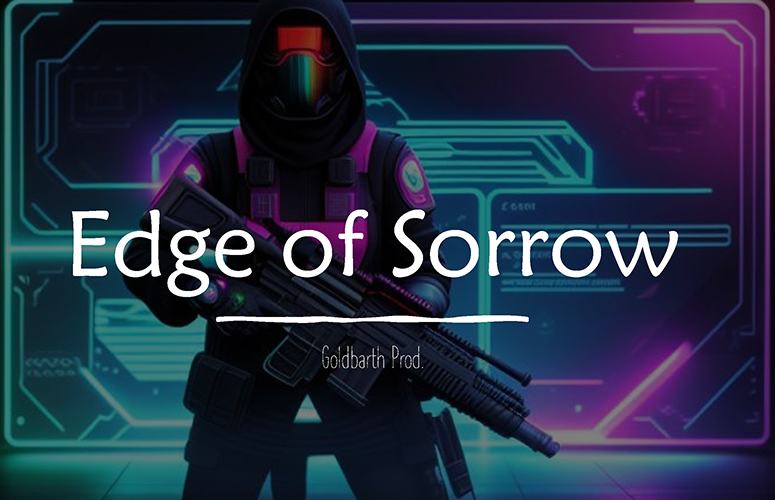

# Edge of Sorrow



**Fight through the waves and build your loadout between rounds.**

A fast-paced, retro-inspired arena FPS for one player.
Face waves of creatures in dark arenas, collect their loot, and spend your earnings on weapons and gear before heading back into the fight.

**Windows · Single-player · Unreal Engine 5.2 · Prototype**

[**Download the Windows build on itch.io**](https://goldbarth.itch.io/edge-of-sorrow) · [Gameplay](#gameplay) · [Controls](#controls) · [Open the project](#open-the-project)

## Gameplay


The loop is simple:

1. Fight through an enemy wave and collect dropped coins and upgrade orbs.
2. Visit the shop to buy weapons and equipment.
3. Equip your loadout in the hideout.
4. Enter the next round.

### Combat and equipment

- **Keep moving:** fast movement, strafing, and a dash ability unlocked by the exoskeleton.
- **Choose your weapon:** five weapons to experiment with as you build your loadout.
- **Collect upgrades:** enemy drops include coins for the shop and orbs that increase firing speed.
- **Add protection:** a force shield provides protection against incoming hits.
- **Find your way out:** leave the arena through an exit portal.

Cel shading, pixelation, and deep shadows give the arenas their retro look.
Headphones help you hear approaching enemies in the darkness.

<details>
<summary>More gameplay: the Equalizer</summary>


</details>

## Controls

| Action | Input |
| --- | --- |
| Move | WASD |
| Look | Mouse |
| Fire | Left mouse button |
| Run | Shift |
| Dash | Space, with the exoskeleton equipped |

## Menus and shop

<table>
  <tr>
    <td width="50%"></td>
    <td width="50%"></td>
  </tr>
  <tr>
    <td align="center">Main menu</td>
    <td align="center">Item and weapon shop</td>
  </tr>
</table>

## About the project

I built Edge of Sorrow during my game-programming studies as my first Unreal Engine game.
The project explores wave-based combat, collectible upgrades, equipment, and a shop between rounds.

Gameplay systems are built primarily with **Unreal Engine Blueprints**.
The repository also contains a small C++ module with a base item actor.

| Location | Contents |
| --- | --- |
| `Content/EdgeOfSorrow/Blueprints/` | Player, enemies, weapons, collectibles, wave logic, and UI |
| `Content/EdgeOfSorrow/Maps/` | Arena maps, main menu, and shop |
| `Content/EdgeOfSorrow/Inputs/` | Enhanced Input actions and mapping contexts |
| `Content/EdgeOfSorrow/PostProcessing/` | Cel shading, darkness, and pixelation materials |
| `Source/EdgeOfSorrow/` | C++ runtime module and base item actor |
| `Config/` | Project settings, input configuration, and default maps |

## Play the prototype

1. Download `EdgeOfSorrow.zip` from the [itch.io page](https://goldbarth.itch.io/edge-of-sorrow).
2. Extract the archive.
3. Run `EdgeOfSorrow.exe` on Windows.

This is a prototype.
Weapon balancing is unfinished, and some weapons are still much stronger than others.

## Open the project

The `.uproject` file is associated with **Unreal Engine 5.2** and targets Windows.
Install that engine version and a compatible Windows C++ build toolchain for the included native module.

```sh
git clone https://github.com/goldbarth/EdgeOfSorrow.git
```

1. Open `EdgeOfSorrow.uproject` in Unreal Engine 5.2.
2. Allow the editor to build the `EdgeOfSorrow` module if prompted.
3. Open `Content/EdgeOfSorrow/Maps/MainMenu` if it is not already loaded.
4. Press Play to start from the main menu.

Blueprint gameplay logic is stored in `.uasset` files and is best explored in the Unreal Editor.

## License

[MIT](LICENSE) · Copyright 2024 Felix Wahl.
